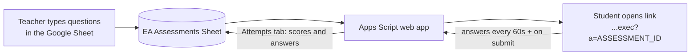

# EA Assessment Platform

A free, timed online assessment for EduBridge Academy. It replaces the paid Google Forms timer add-ons.

Each student gets their own countdown that starts when they click **Start**. Google's server keeps the official time, so refreshing the page, closing the tab or changing the computer clock never gives anyone extra time. When time runs out, the page submits by itself. Multiple-choice answers are marked automatically, and everything lands in a Google Sheet.

## How it fits together



## For teachers: running an assessment

### 1. Add the assessment (tab `Assessments`, one row)

| Column | What to type | Example |
|---|---|---|
| AssessmentId | A short code with no spaces. Students will see it in their link. | `AP-WK3` |
| Title | The name students see | `Week 3 Quiz` |
| DurationMinutes | How long each student gets once they click Start | `45` |
| OpensAt | Optional. Earliest time anyone can start. Leave blank for "any time". | `2026-11-20 09:00` |
| ClosesAt | Optional. Hard stop. Late starters get less time, never past this. Leave blank for "no hard stop". | `2026-11-20 12:00` |
| Status | `Open` lets students start. `Closed` stops new starts. | `Closed` |

### 2. Add the questions (tab `Questions`, one row per question)

| Column | What to type |
|---|---|
| AssessmentId | The same code as above |
| QNo | Question number: 1, 2, 3... |
| Type | `MCQ` (pick one, marked automatically), `SHORT` (one-line answer, you mark it) or `PARAGRAPH` (long answer, you mark it) |
| Question | The question text |
| OptionA to OptionD | The choices (MCQ only). For True/False, put `True` in OptionA, `False` in OptionB and leave C and D empty. |
| Answer | The correct letter for MCQ: `A`, `B`, `C` or `D`. Leave blank for SHORT and PARAGRAPH. |
| Marks | Marks for the question. Blank means 1. |
| Section | Optional heading shown above the question, such as `Section A: Credit Risk` |

Examples:

| AssessmentId | QNo | Type | Question | OptionA | OptionB | OptionC | OptionD | Answer | Marks | Section |
|---|---|---|---|---|---|---|---|---|---|---|
| AP-WK3 | 1 | MCQ | What is 15% of 200? | 20 | 30 | 35 | 40 | B | 1 | Section A: Numbers |
| AP-WK3 | 2 | MCQ | A secured loan carries no credit risk. | True | False | | | B | 1 | Section A: Numbers |
| AP-WK3 | 3 | SHORT | In one sentence, what is working capital? | | | | | | 2 | Section B: Written |
| AP-WK3 | 4 | PARAGRAPH | Explain two early warning signs of credit stress. | | | | | | 5 | Section B: Written |

**Tip:** if a question or option starts with `=` (for example an Excel formula such as `=PMT(...)`), type an apostrophe first: `'=PMT(24%/12,36,-5000000)`. Otherwise Google Sheets tries to calculate it.

### 3. Share the link

The student link is your web app address with `?a=` and the AssessmentId on the end:

```
https://script.google.com/macros/s/<your deployment id>/exec?a=AP-WK3
```

Find your web app address in the Apps Script editor under **Deploy > Manage deployments**. Keep it out of public places: anyone with the link and an open AssessmentId can start a test.

### 4. Open and close it

- Set `Status` to `Open` when students should be able to start, and to `Closed` when you are done.
- Or set `OpensAt` and `ClosesAt` and leave Status as `Open`.
- Closing only stops **new** starts. A student already writing keeps their own deadline (but never past `ClosesAt`).

### 5. Read the results (tab `Attempts`, one row per student)

| Column | Meaning |
|---|---|
| Name, Email | What the student typed |
| StartedAt, DeadlineAt | When they clicked Start, and when their time ran out |
| SubmittedAt | When their answers were accepted |
| Status | `IN_PROGRESS` (still writing or never came back), `SUBMITTED` (submitted on time), `AUTO_SUBMITTED` (time ran out; their last saved answers were used) |
| AutoScore, AutoMax | Marks earned on MCQs, out of the MCQ total |
| NeedsManualMarking | `Yes` if the test has SHORT or PARAGRAPH questions for you to mark |
| Answers | Every answer, one line per question, easy to read |
| AnswersJSON | The same answers in a format the system reads back. Do not edit. |
| LastSavedAt | The last autosave |
| AllowNewDevice | See below |

To mark written answers, read the `Answers` column and add your marks in a new column to the right (the system never touches columns after `AllowNewDevice`).

### Student changed device or browser mid-test?

For safety, only the browser that started a test can continue it, so nobody can open a classmate's test by typing their email. If a student's laptop dies and they need to continue on another device, type `Yes` in their `AllowNewDevice` cell. They can then continue on the new device once. **Their timer does not reset**: it kept running the whole time.

### Limits

- About 60 to 80 students can sit a test at the same moment. For bigger groups, run it in batches.
- Answers are saved every 60 seconds and on submit. If a student's internet drops right at the end, their last autosave counts.
- A submission up to 30 seconds after the deadline is accepted, to cover slow networks.

## First-time setup (done once)

1. In the Apps Script editor, open `Main.gs`, choose `setup` in the function dropdown and click **Run**. Approve the permissions. This creates the `Assessments`, `Questions` and `Attempts` tabs (and an "EA Assessments" Sheet if the script is not attached to one), plus a 5-minute `DEMO` quiz.
2. Choose `smokeTest` and click **Run**. It should end with "Smoke test passed" and add one test row to `Attempts` (safe to delete).
3. Try the demo yourself: open your web app link with `?a=DEMO` on the end.

## For developers

- Code lives in `src/` and is uploaded to Google with [clasp](https://github.com/google/clasp): `clasp push`, then `clasp redeploy <deploymentId> --description "..."` so the student link stays the same.
- Rules are plain JavaScript that also run in Node: `npm test` runs the tests (Node 22+).
- `src/Seed_*.js` files hold real assessments with their answer keys. They are git-ignored on purpose (this repo is public) but still uploaded by clasp, and `setup` adds any assessment in them that is not yet in the Sheet.
