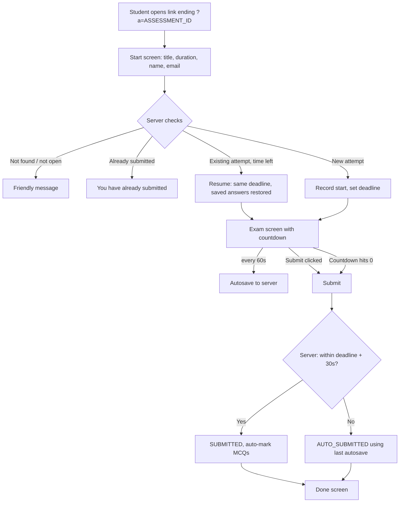

# Timed Assessment Platform: Design

**Date:** 2026-11-11
**Owner:** EduBridge Academy (EA)
**Problem:** Google Forms cannot time an assessment without paid add-ons. We need a free way to give each student a countdown that starts when they open the assessment and submits automatically when time runs out.

## Decisions

1. **Platform:** Google Apps Script web app bound to one Google Sheet ("EA Assessments"). Free, runs on the owner's Google account, no hosting bill, results land in the Sheet.
2. **Authoring:** The teacher writes assessments and questions directly in Sheet tabs. No admin screens.
3. **Timer rule:** Each student gets their own countdown, starting the moment they click **Start**. Deadline = the earlier of (start time + duration) and the assessment's closing time.
4. **The server is the judge of time.** The browser only displays the countdown. Refreshing, closing the tab, switching device or changing the computer clock never resets or extends the time.
5. **Autosave:** Answers are saved to the server every 60 seconds and on submit. If a student's time runs out while offline, their last autosaved answers are what count.
6. **Grace period:** A submission arriving up to 30 seconds after the deadline is accepted (covers slow networks). Later than that, the last autosave before the deadline is kept and the attempt is marked `AUTO_SUBMITTED`.
7. **One attempt per email per assessment.** Email is matched ignoring case and surrounding spaces.
8. **Question types:** `MCQ` (options A to D, auto-marked), `SHORT` and `PARAGRAPH` (free text, marked by the teacher by hand).
9. **Identity:** Students type name and email. No Google sign-in required (students may not have Google accounts).
10. **Branding:** EduBridge teal `#154B54`, green `#5EB229`, font Montserrat.

## Sheet tabs

| Tab | Columns |
|---|---|
| `Assessments` | AssessmentId, Title, DurationMinutes, OpensAt, ClosesAt, Status (`Open` / `Closed`) |
| `Questions` | AssessmentId, QNo, Type (`MCQ` / `SHORT` / `PARAGRAPH`), Question, OptionA, OptionB, OptionC, OptionD, Answer (letter A to D for MCQ, blank otherwise), Marks |
| `Attempts` | AttemptId, AssessmentId, Name, Email, StartedAt, DeadlineAt, SubmittedAt, Status, AutoScore, AutoMax, NeedsManualMarking, Answers (readable), AnswersJSON, LastSavedAt |

OpensAt and ClosesAt may be blank (meaning "no limit"). Time zone: Africa/Lagos.

## Student flow

## Out of scope (for now)

Tab-switch detection, question shuffling, emailing results, admin dashboard, Google sign-in.

## Known limit

Free Apps Script allows about 30 requests running at the same moment per owner account. With autosave every 60 seconds this comfortably covers a class of 60 to 80 students; very large simultaneous sittings should be split into batches.
